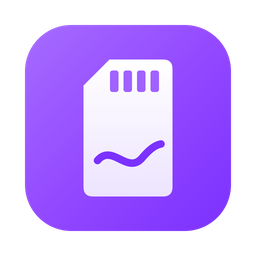
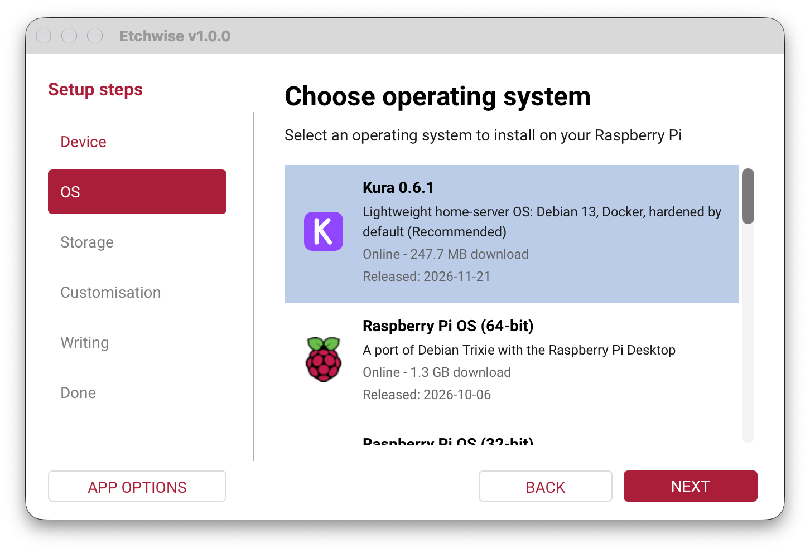
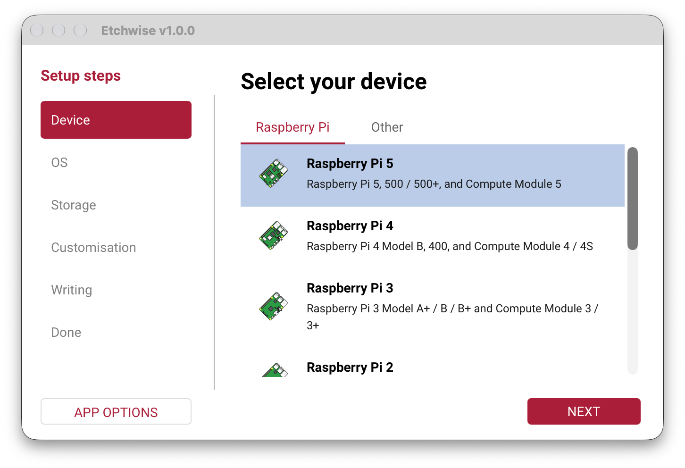
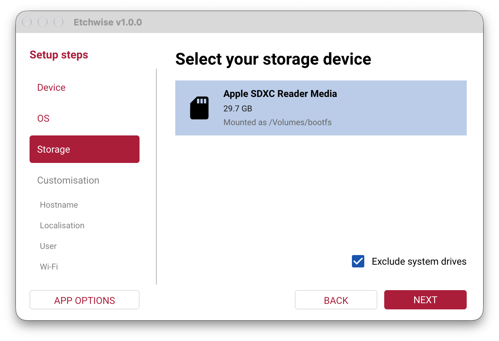
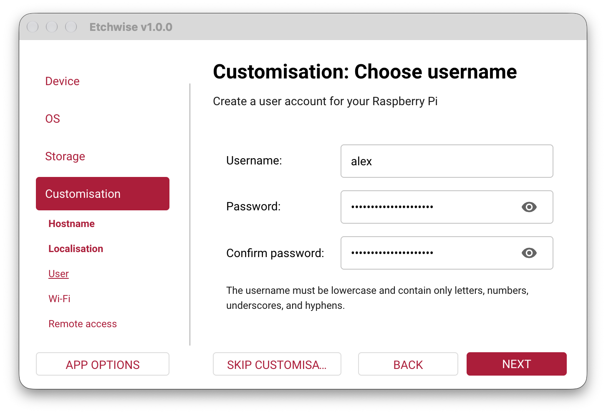
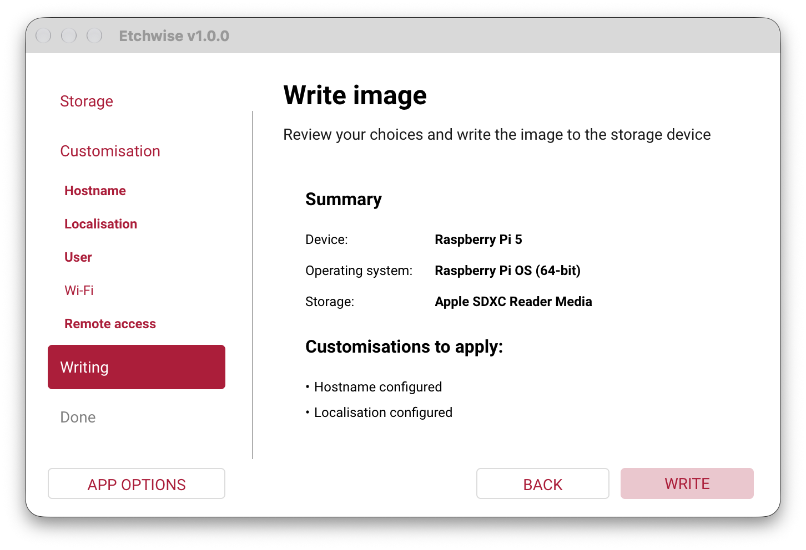

<p align="center">
  
</p>

<h1 align="center">Etchwise</h1>

<p align="center">
  Write an operating system to an SD card, USB drive or SSD,<br>
  and have it set up before its first boot.
</p>

<p align="center">
  <a href="https://github.com/cbabil/etchwise/releases/latest"></a>
  
  <a href="LICENSE"></a>
</p>

<p align="center">
  
</p>

Etchwise is a disk imager for Raspberry Pi computers and for PCs such as the
Intel NUC. You pick a device, an operating system and a drive; Etchwise
downloads the image, writes it, reads it back to check it, and adds your user
account, SSH keys, host name, Wi-Fi, time zone and keyboard so the machine is
ready the first time it starts.

It is a Rust, Tauri and React port of
[Raspberry Pi Imager](https://github.com/raspberrypi/rpi-imager), with a
second list of images for PCs and no usage statistics.

## Contents

- [Features](#features)
- [Download](#download)
- [How it works](#how-it-works)
- [What it can write](#what-it-can-write)
- [First-boot setup](#first-boot-setup)
- [Platform support](#platform-support)
- [Command line](#command-line)
- [Build from source](#build-from-source)
- [Project layout](#project-layout)
- [Known limits](#known-limits)
- [Licence](#licence)

## Features

- **Raspberry Pi and PC images in one app.** The official Raspberry Pi list,
  plus Kura, Ubuntu, Debian and Proxmox VE for UEFI PCs.
- **Ready at first boot.** User, password, SSH keys, host name, Wi-Fi, time
  zone and keyboard are written in the format each system reads.
- **Every write is verified.** The drive is read back and checked against the
  image's SHA-256.
- **Safe by default.** System drives are hidden, and nothing is erased before
  you confirm.
- **Your own images.** Use a local file, or add your own image list on top of
  the built-in ones.
- **No usage statistics.** Etchwise only downloads image lists and images.
- **27 languages**, from Raspberry Pi Imager's translations.

## Download

**[Download Etchwise for macOS](https://github.com/cbabil/etchwise/releases/latest)**
(Apple silicon, macOS 12 or later)

1. Open the `.dmg` and drag Etchwise to Applications.
2. Etchwise is not notarized by Apple, so the first launch is blocked. Open
   **System Settings > Privacy & Security**, find the message about Etchwise
   and choose **Open Anyway**. This is needed once.

Each release has a `SHA256SUMS` file to check the download:

```sh
shasum -a 256 -c SHA256SUMS
```

There is no Linux, Windows or Intel Mac download yet; see
[Platform support](#platform-support).

## How it works

| | |
|:---:|:---:|
|  |  |
| **1. Device and OS.** Pick a Raspberry Pi model, or a PC from the Other tab, then an image that runs on it. | **2. Storage.** Pick the drive. System drives stay hidden. |
|  |  |
| **3. Setup.** Host name, user, Wi-Fi and remote access for the first boot. | **4. Write.** Review, confirm, and Etchwise writes and verifies the drive. |

## What it can write

- **The official Raspberry Pi list**, as in Raspberry Pi Imager (Raspberry Pi
  tab of the Device step).
- **Etchwise's own list** (Other tab), built into the app
  ([`repos/etchwise.json`](repos/etchwise.json)):
  - **[Kura](https://github.com/cbabil/kura)**, a home-server OS, read from its
    latest release. It comes as an image for the Raspberry Pi 5, a small USB
    installer that puts Kura on a PC's internal drive, and a PC image that
    runs from the drive it is written to.
  - Installers for **Ubuntu Server 26.04.1 LTS**, **Ubuntu Desktop 26.04.1
    LTS**, **Debian 13.7** (netinst) and **Proxmox VE 9.2**.
- **Your own image** (Use custom), and **an extra list** of your own
  (App Options > Extra Repository), merged on top.
- **Erase**, which formats the drive as FAT32.

## First-boot setup

The setup screens are turned into what each system reads when it first
starts:

| Image | What Etchwise writes |
|---|---|
| Raspberry Pi OS and other Pi images | cloud-init files or `firstrun.sh`, as Raspberry Pi Imager |
| Ubuntu Server (PC) | Ubuntu autoinstall `user-data` on a small `CIDATA` partition added after the image |
| Kura (Pi 5 and PC) | `kura-setup.json` on the boot or EFI partition |

The user name must be lowercase letters, digits, `_` or `-`, and not a name
the system already uses (for example `root`). SSH keys can be typed, pasted
(PuTTY keys are converted) or loaded from a file.

## Platform support

| | Status | Drive access |
|---|---|---|
| macOS (Apple silicon) | Released, tested end to end | DiskArbitration and `authopen` (admin prompt) |
| macOS (Intel) | No build yet | Same code as Apple silicon |
| Linux | Code complete, not yet run on real hardware | `lsblk` and udisks2 (polkit prompt) |
| Windows | Code complete, not yet run on real hardware | Storage IOCTLs on `\\.\PhysicalDriveN` (runs as administrator) |

Most of Etchwise is portable. The part that touches drives lives in
`crates/imager-platform`, with one module per operating system. The Linux and
Windows modules are unit tested and type-checked with `make cross-check`, but
they have never written a real drive, so they are not packaged.

## Command line

The app can also write an image without its window:

```sh
/Applications/Etchwise.app/Contents/MacOS/etchwise --cli [options] <image> <drive>
```

`<image>` is a file or URL and `<drive>` a device such as `/dev/disk4`. Run it
with `--cli --help` for the options (expected SHA-256, cloud-init files,
skipping verification or eject). System drives are refused unless
`--enable-writing-system-drives` is given.

## Build from source

Requirements: macOS, [rustup](https://rustup.rs) (the toolchain is pinned in
`rust-toolchain.toml`) and [bun](https://bun.sh).

```sh
make install   # JS dependencies and git hooks
make dev       # run with hot reload (REPO=file.json for another OS list)
make build     # release .app
make dmg       # release .app and .dmg
make check     # formatting, lint, tests and the 90% coverage gates
make clean     # remove build output
```

There is no CI: run `make check` before pushing, and `make cross-check`
(needs `zig` and `cargo-zigbuild`) after touching the Linux or Windows
module.

## Project layout

| Path | What it is |
|---|---|
| `crates/imager-core` | OS lists, settings, first-boot setup generators, the write pipeline (download, decompress, write, verify, customise), cache, erase, Secure Boot signing |
| `crates/imager-platform` | Drive list, unmount and eject, raw device access, sleep inhibition and Wi-Fi prefill for macOS, Linux and Windows |
| `crates/imager-rpiboot` | USB boot of Compute Modules (rpiboot, fastboot); off by default (App Options > Debug) |
| `apps/desktop/src-tauri` | The Tauri app: one `imager` command and its events, the CLI mode, `etchwise://` links |
| `apps/desktop/src` | The UI (React and MUI), with the upstream translations |
| `repos/etchwise.json` | Etchwise's own image list |

## Known limits

- Linux and Windows writing is untested on real hardware and has no package
  (see [Platform support](#platform-support)).
- The macOS app is not notarized (see [Download](#download)).
- Ubuntu Server autoinstall has not been tried on a real PC, and drives with
  4096-byte sectors are untested.
- Raspberry Pi Connect's sign-in returns its token to Raspberry Pi Imager's
  link scheme; paste the token by hand.
- Compute Module USB boot is tested against mocked devices only.
- The app does not check for its own updates yet.

## Licence

Apache License 2.0 ([LICENSE](LICENSE)). Etchwise is based on Raspberry Pi
Imager, Copyright (C) 2020 Raspberry Pi Ltd; see [NOTICE](NOTICE). "Raspberry
Pi" is a trademark of Raspberry Pi Ltd; Etchwise is not affiliated with or
endorsed by Raspberry Pi Ltd.
